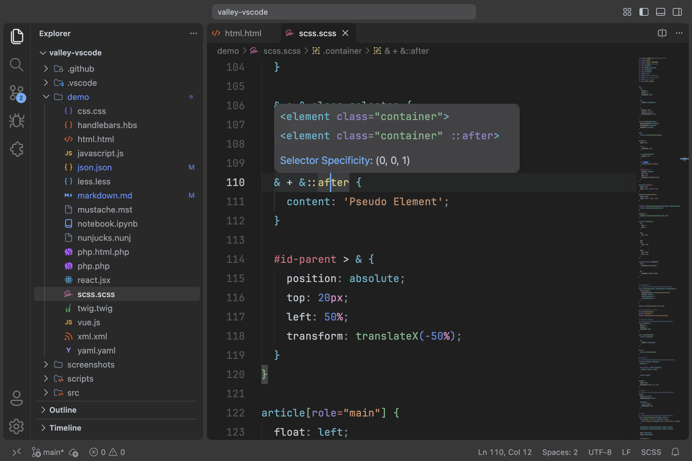
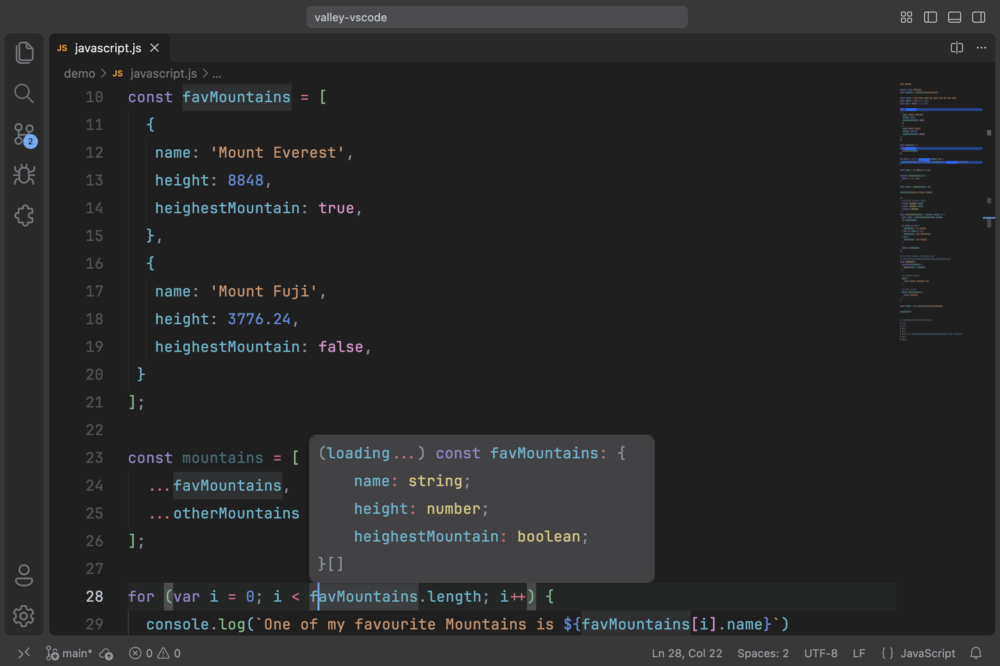
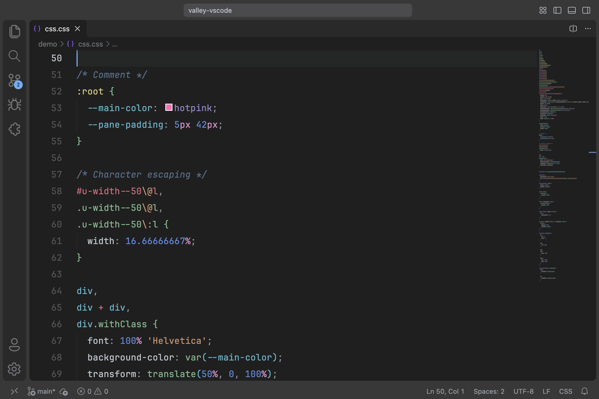
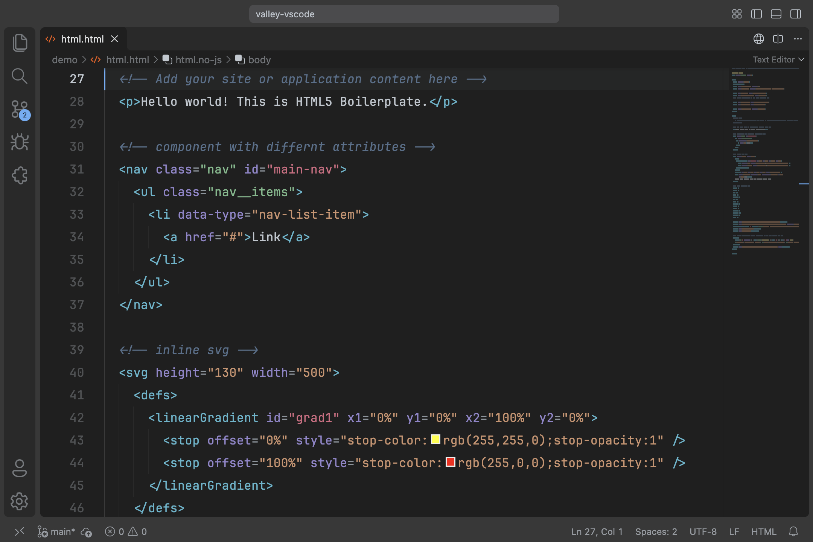
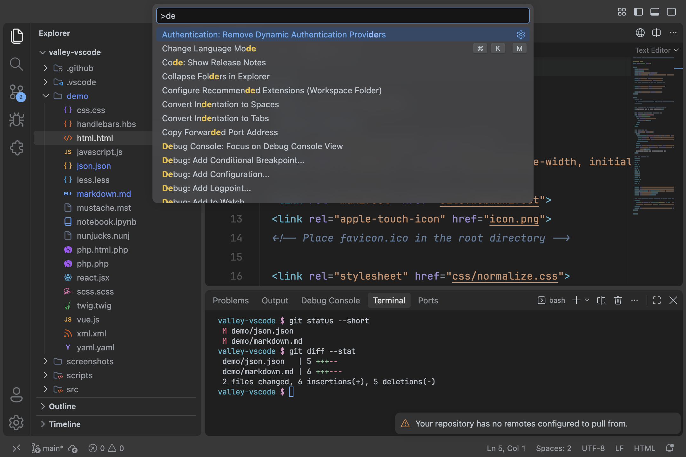
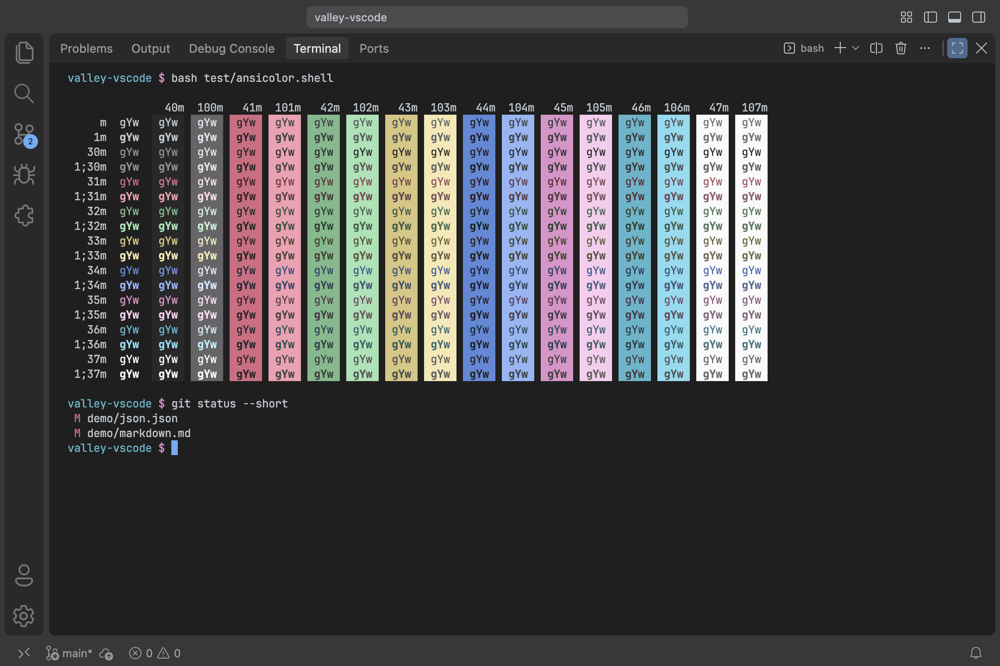
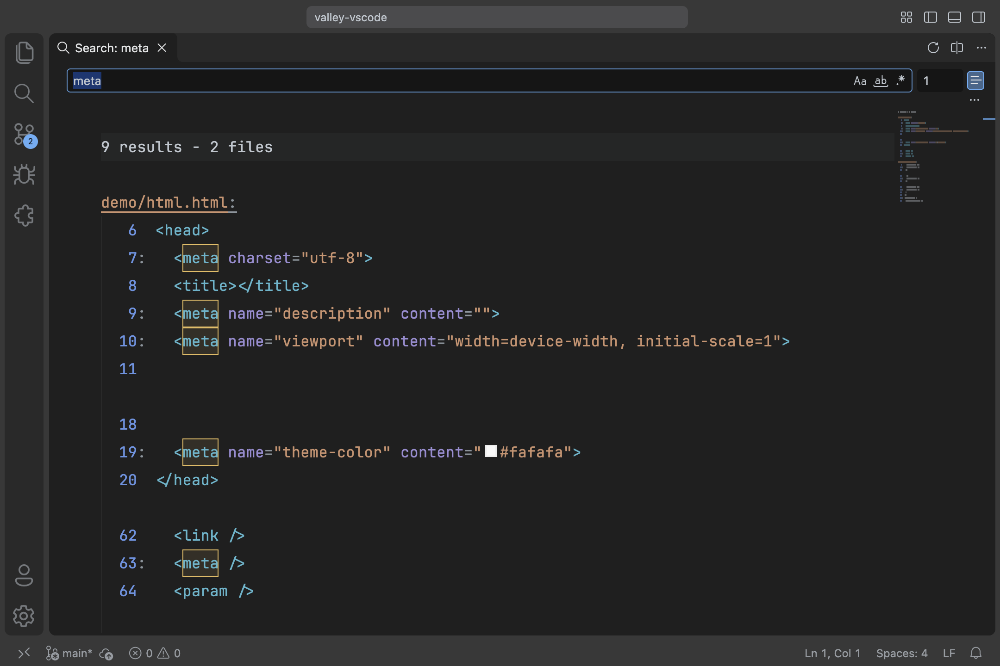

<div align="center">

  # Valley Theme for Visual Studio Code
  [Valley](https://marketplace.visualstudio.com/items?itemName=TimGrochowski.valley-vscode) is a simple theme for Visual Studio Code without visual noise. Created with handpicked and vivid colors, appropriate contrast and a lot of love to help you focus on your code.

  [](https://marketplace.visualstudio.com/items?itemName=TimGrochowski.valley-vscode)
  [](https://marketplace.visualstudio.com/items?itemName=TimGrochowski.valley-vscode)

  [](https://vscode.dev/theme/timgrochowski.valley-vscode)

  

</div>

----

## My motivation to build Valley
> I've always had this feeling about themes: "If I use this theme, it will make me a better developer." Of course that's silly, but I couldn't shake it and changed my theme many times. I never felt completely comfortable with any of them and was kind of blocked in my work, because the colors weren't harmonious and the contrast was either missing or much too strong. All in all, I always lacked orientation, because something about the design was missing. So I made my own. Of course this is a **very personal perception**, and Valley won't be a perfect fit for everyone. But maybe a few people will have as much fun with Valley as I do.

## How to Install
- Open the **"Extensions"** sidebar in Visual Studio Code
- Search for `Valley`
- Choose "Valley" by Tim Narr and click **"Install"**
- [Select the theme](https://code.visualstudio.com/docs/configure/themes#_color-themes): "Valley", or "Valley Italic", which also sets keywords and attributes in italics

**or via "Quick Open, Go to File..."**

- Open **"Quick Open, Go to File..."** by pressing `⌘P` on macOS or `Ctrl+P` on Windows/Linux
- Paste `ext install TimGrochowski.valley-vscode`
- Press Enter

**And if you like Valley, rate it or write a review in the [marketplace](https://marketplace.visualstudio.com/items?itemName=TimGrochowski.valley-vscode&ssr=false#review-details)** ✨

## Screenshots
You can find more screenshots [here](https://github.com/timnarr/valley-vscode/blob/master/screenshots.md). **Or even better: try Valley live [on vscode.dev](https://vscode.dev/theme/timgrochowski.valley-vscode).**

**Vivid and pleasant syntax color palette for long coding sessions.**







**To improve orientation, I have colored the surfaces according to their z-axis. The closer a surface is to the user, the brighter it is.**



**I aimed for WCAG AA: the syntax colors and most text on the workbench reach a contrast ratio of at least 4.5:1. Deliberately subdued elements such as comments, breadcrumbs and placeholders stay above 3:1.**



**Features like search or Git have their own colors and use them consistently. For example, all search-related colors are yellow.**



## Color Palette
You can explore Valley's color palette on [calcolor.co](https://calcolor.co/palette/915560412).

## Personalization
If something doesn't look the way you want, feel free to override it in your user settings and give Valley your own personal touch. For more information, see ["Customize a color theme"](https://code.visualstudio.com/docs/configure/themes#_customize-a-color-theme) in the Visual Studio Code docs.

## Recommended Settings
I highly recommend the following settings to improve the readability and appearance of Visual Studio Code. They are also the settings used in the screenshots:

```json
"workbench.colorTheme": "Valley",
// Editor
"editor.padding.top": 24,
"editor.padding.bottom": 24,
// Typography
// https://www.jetbrains.com/lp/mono/
"editor.fontFamily": "JetBrains Mono, monospace",
"editor.fontLigatures": true,
"editor.fontSize": 16,
"editor.lineHeight": 30,
"editor.letterSpacing": 0.2,
"editor.suggestFontSize": 14,
"editor.fontWeight": "400",
"workbench.tree.indent": 16,
// Minimap
"editor.minimap.renderCharacters": false,
// Icon Theme
// I like using the 'Symbols' Icon Theme
// https://marketplace.visualstudio.com/items?itemName=miguelsolorio.symbols
"workbench.iconTheme": "symbols",
// Product Icon Theme
// I like using the 'Fluent Icons' Product Icon Theme
// https://marketplace.visualstudio.com/items?itemName=miguelsolorio.fluent-icons
"workbench.productIconTheme": "fluent-icons",
```

## Feedback and Issues
If you have suggestions or feedback, or if you found a bug, please [open an issue](https://github.com/timnarr/valley-vscode/issues) and let me know. I appreciate all feedback, and screenshots are very welcome.

## Valley Ports
- [Valley for iTerm2](https://github.com/timnarr/valley-iterm)
- [Valley for Windows Terminal, by Carl Underwood](https://github.com/carl-underwood/valley-windowsterminal)

## Tools
Many great tools helped me create this theme:
- [whocanuse.com](https://whocanuse.com/)
- [accessible-colors.com](https://accessible-colors.com/)
- [contrast-grid.eightshapes.com](https://contrast-grid.eightshapes.com/)
- [color.review](https://color.review/)
- [abc.useallfive.com](https://abc.useallfive.com/)
- [contrast-finder.tanaguru.com](https://contrast-finder.tanaguru.com/)
- [calcolor.co](https://calcolor.co)

## License
**Valley Theme** by **Tim Narr** is licensed under the ["Creative Commons Attribution-NonCommercial 4.0 International"](https://creativecommons.org/licenses/by-nc/4.0/) License.

***

The syntax color palette was partly inspired by the dark theme of the Google Chrome DevTools. I used language scopes from the Visual Studio Code Dark+ theme to jumpstart Valley.

***

Valley is available for free in the [Visual Studio Marketplace](https://marketplace.visualstudio.com/items?itemName=TimGrochowski.valley-vscode). If you enjoy using it and want to say thank you, you can [buy me a coffee](https://buymeacoffee.com/tim.n) or rate it and write a review in the [marketplace](https://marketplace.visualstudio.com/items?itemName=TimGrochowski.valley-vscode&ssr=false#review-details) ✨.

**Enjoy** ❤️
